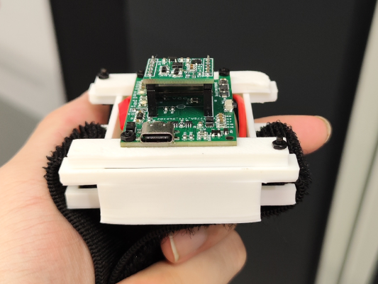
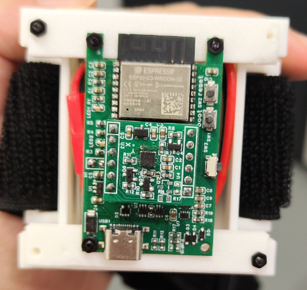
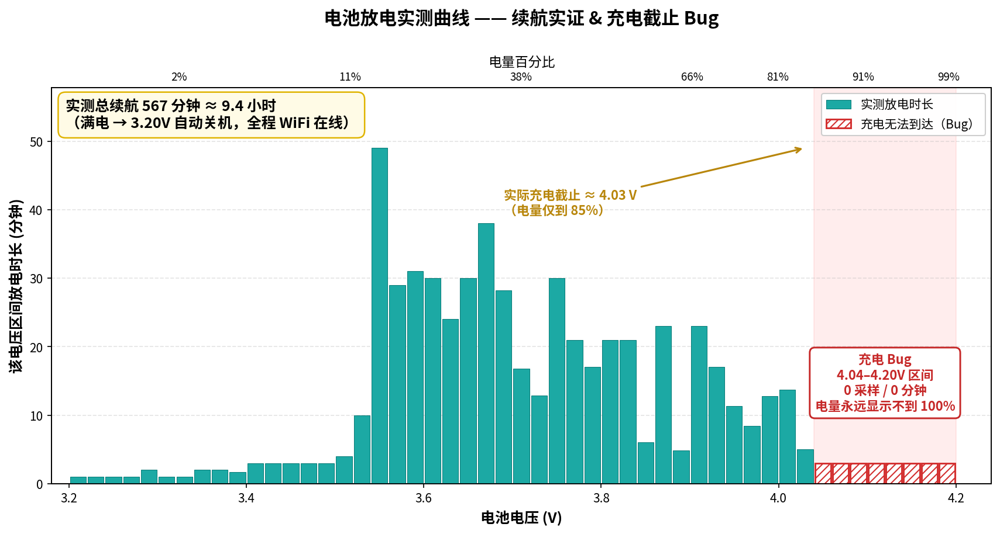

# 🧭 Wireless IMU — 基于 ESP32-C3 的无线惯性测量单元

基于 ESP32-C3 + ICM-20948 的无线九轴 IMU 姿态追踪系统。固件通过 WiFi 将 VQF 融合后的四元数实时传输至上位机，实现低延迟 3D 姿态可视化，支持多设备同时连接、磁力计椭球校准和 OTA 无线固件升级。

<div align="center">
  
  
</div>

---

## ✨ 特性

- **九轴姿态解算**：ICM-20948 (陀螺仪 + 加速度计 + AK09916 磁力计)，225Hz 采集，VQF 算法本地实时解算
- **无线传输**：WiFi STA 模式，UDP 二进制协议（Q15 紧凑格式）+ TCP 命令通道，低延迟高吞吐
- **自动设备发现**：mDNS 服务广播 + UDP Beacon，上位机即插即用
- **多设备管理**：上位机 Dashboard 同时连接和管理多台 IMU 设备
- **磁力计校准**：运行时椭球校准，校准数据持久化至 NVS，上位机提供 3D 点云 + 球面覆盖热力图 + 范数曲线实时可视化
- **OTA 固件升级**：通过 WiFi HTTP 推送固件，无需数据线
- **电源管理**：锂电池供电，ADC 电池电压监测，智能剩余时间预测（电压分箱 + 能量回归融合），低电量自动关机，短按查看电量 / 长按 3 秒关机
- **WS2812 LED 指示**：WiFi 连接状态、电池电量指示、长按关机动画
- **3D 打印外壳**：包含 STEP 格式的电池仓外壳和连接器外壳

---

## 📁 项目结构

```
PROJECT_wirelessIMU/
├── README.md                            # 本文件
├── PROTOCOL.md                          # 📡 通信协议（端口 / 数据包 / 命令 / OTA 全文）
├── 图片/                                # 实物展示图片 & 实测曲线图
├── 测试数据/                            # 实测原始数据（可复现）
│   └── battery_vbin_B4.csv              # 电池放电分箱实测数据（电压区间→放电时长）
├── 3D打印文件/                          # 3D 打印外壳 (STEP 格式)
│   ├── batteryBoxNew-Body001.step       # 电池仓外壳
│   └── connter-Body.step                # 连接器外壳
├── BOM/                                 # BOM 物料清单
│   └── 淘宝imu+esp32关键元件采购表.xlsx  # 含关键元件购买链接
├── HARDWARE/                            # 硬件 PCB 设计文件 (EPRO2 格式, 立创 EDA)
│   ├── esp32c3信息传输板.epro2           # ESP32-C3 无线传输板
│   └── ICM-20948测试板.epro2             # ICM-20948 传感器测试板
└── SOFTWARE/                            # 软件
    ├── ESP32C3固件/                      # ESP32-C3 固件 (ESP-IDF 5.x)
    │   ├── main/
    │   │   ├── main.c                   # 主程序入口
    │   │   ├── imu_config.h             # 🔧 传感器 & 传输模式配置（修改此文件切换配置）
    │   │   ├── i2c_scanner.c            # I2C 地址扫描工具（独立程序）
    │   │   ├── CMakeLists.txt
    │   │   └── 引脚描述/
    │   │       └── esp32信息传输板引脚描述.md
    │   ├── components/
    │   │   ├── icm20948/                # ICM-20948 九轴驱动
    │   │   ├── lsm9ds1/                 # LSM9DS1 九轴驱动（可选）
    │   │   ├── mpu9250/                 # MPU9250 六轴驱动（可选）
    │   │   ├── vqf/                     # VQF 姿态融合算法
    │   │   ├── wifi_transport/          # WiFi 传输层 (UDP + TCP + mDNS)
    │   │   ├── power_manager/           # 电源管理（电池监测、按键、自动关机）
    │   │   ├── led_manager/             # WS2812 LED 指示灯管理
    │   │   ├── mag_calibration/         # 磁力计椭球校准
    │   │   └── ota_update/              # OTA 无线固件更新
    │   ├── CMakeLists.txt
    │   ├── partitions.csv               # OTA 双分区表 (4MB Flash)
    │   └── sdkconfig
    └── 多IMU数据展示/                    # Python 上位机 (MIT)
        ├── multi_imu_dashboard.py        # Dashboard UI (Pygame + OpenGL)
        ├── multi_imu_core.py             # 核心服务（设备发现、连接、控制 API）
        ├── api_reference.md              # MultiImuService 完整 API 参考
        ├── requirements.txt              # Python 依赖
        └── LICENSE                       # MIT License
```

> 各顶层子目录（`HARDWARE/`、`3D打印文件/`、`SOFTWARE/ESP32C3固件/`、`SOFTWARE/多IMU数据展示/`）下均放置了对应协议的 `LICENSE` 全文，详见文末[开源协议](#-开源协议)。

---

## 🔧 硬件

### ESP32-C3 信息传输板引脚分配

| GPIO | 功能 | 说明 |
|------|------|------|
| IO5  | 电池电压检测 | ADC 采样，读取值 × 2 = 电池实际电压 |
| IO6  | I2C SDA | 连接 IMU 传感器 |
| IO7  | I2C SCL | 连接 IMU 传感器 |
| IO1  | IMU 中断 | ICM-20948 数据就绪中断 |
| IO2  | 按键检测 | ADC 采样，读取值 × 2 = 按键电压，> 1.5V 视为按下 |
| IO3  | 电源来源检测 | HIGH = 电池供电，LOW = USB 供电 |
| IO10 | 系统使能 | 启动时拉高，关机时拉低（自锁电路控制） |

### 传感器参数

- **IMU**：ICM-20948，陀螺仪 ±2000°/s，加速度计 ±8g，采样率 225Hz
- **磁力计**：AK09916（ICM-20948 内置），100Hz 连续测量模式
- **通信**：I2C 400kHz，地址 0x68 (ICM-20948) / 0x0C (AK09916)

### PCB 文件

硬件设计文件为立创 EDA (`.epro2`) 格式，包含：
- **ESP32-C3 信息传输板**：集成 ESP32-C3、锂电池充放电、WS2812 LED、按键和系统自锁电路
- **ICM-20948 测试板**：集成 ICM-20948 九轴传感器，通过排针/排线与传输板连接

### BOM 物料清单

见 `BOM/淘宝imu+esp32关键元件采购表.xlsx`，包含所有关键元件的规格说明和淘宝购买链接。

### 3D 打印外壳

- `batteryBoxNew-Body001.step` — 电池仓主体外壳
- `connter-Body.step` — 连接器外壳

> ⚠️ **已知硬件问题**：ICM-20948 测试板 PCB 丝印上 X/Y 轴标注有误，实际轴方向以 ICM-20948 芯片数据手册定义为准。

---

## 💻 固件

### 环境要求

- **ESP-IDF** v5.4.x（推荐 v5.4.2）
- **Python** 3.8+（用于上位机）
- **ESP32-C3** （4MB Flash）

### 配置

所有关键配置集中在 `SOFTWARE/ESP32C3固件/main/imu_config.h`：

```c
// 传感器选择 (当前默认 ICM-20948)
#define IMU_SENSOR_TYPE      IMU_SENSOR_ICM20948

// 输出模式
#define OUTPUT_MODE          OUTPUT_MODE_VISUALIZER  // 四元数协议（供上位机使用）

// 传输通道
#define TRANSPORT_MODE       TRANSPORT_MODE_WIFI     // WiFi 无线传输

// ICM-20948 读取触发方式
#define ICM_READ_TRIGGER_MODE  ICM_READ_TRIGGER_INT  // 中断触发（推荐）

// 磁力计开关
#define USE_MAGNETOMETER     1                        // 启用九轴模式
```

WiFi SSID 和密码通过 `menuconfig` 配置：

```bash
cd SOFTWARE/ESP32C3固件
idf.py menuconfig
# 导航到: VQF WiFi Transport → 填写 WiFi SSID 和 WiFi Password
```

### 编译与烧录

```bash
cd SOFTWARE/ESP32C3固件

# 编译
idf.py build

# 烧录（根据实际串口修改端口）
idf.py -p /dev/ttyUSB0 flash

# 查看日志
idf.py -p /dev/ttyUSB0 monitor
```

### I2C 地址扫描

如需确认传感器连接，可将 `main.c` 替换为 `i2c_scanner.c` 编译烧录，串口会打印所有 I2C 设备地址。注意需要修改 `i2c_scanner.c` 中的引脚定义以匹配实际接线。

---

## 🖥️ 上位机

上位机为 Python 程序，提供多设备管理、3D 实时姿态可视化和磁力计校准界面。

### 依赖安装

```bash
pip install pygame PyOpenGL numpy
```

### 启动

```bash
cd SOFTWARE/多IMU数据展示
python multi_imu_dashboard.py
```

### 功能概览

| 功能 | 说明 |
|------|------|
| **自动设备发现** | 监听 UDP Beacon，新设备上线自动出现在设备列表 |
| **3D 姿态显示** | OpenGL 实时渲染 PCB 板模型，根据四元数旋转 |
| **多设备管理** | 支持同时连接多台 IMU，UP/DOWN 键切换选中设备 |
| **电池监控** | 实时显示电压、电量百分比、预估剩余时间、充电状态 |
| **磁力计校准** | 3D 点云可视化 + 球面覆盖热力图 + 范数曲线，实时引导用户旋转方向 |
| **OTA 固件升级** | 按 U 键向选中设备推送 `build/vqf_esp32.bin` 固件 |
| **远程关机** | 按 O 键远程关闭选中设备 |

### 操作指南

| 按键 | 功能 |
|------|------|
| ↑ / ↓ | 切换选中的 IMU 设备 |
| C | 开始磁力计校准 |
| X | 退出校准视图 / 停止校准采集 |
| E | 擦除已保存的磁力计校准参数 |
| O | 远程关机 |
| U | OTA 固件升级 |
| ESC | 退出程序 |

### 磁力计校准流程

1. 按 **C** 键开始校准，进入校准可视化界面
2. 缓慢将设备向各个方向旋转，尽量覆盖整个球面
3. 界面右侧显示球面覆盖热力图，左下角显示范数曲线
4. 当覆盖率和范数稳定性满足条件时，底部会提示"校准完成条件已满足"
5. 按 **X** 停止采集，设备自动计算校准参数并保存至 NVS
6. 校准后的数据在断电后依然有效

### 通信协议

设备通过 WiFi 与上位机建立双通道通信：

- **UDP 4211**（数据通道）：二进制四元数旋转包（12 字节，Q15 格式）和文本消息
- **TCP 4210**（命令通道）：上位机发送控制命令（如 `$CMD,CAL_START`、`$CMD,OFF`）
- **UDP 4212**（发现通道）：设备周期性广播 Beacon 帧，上位机自动发现
- **HTTP 8080**（OTA 通道）：接收固件上传

> 完整协议规格（数据包字节布局、Q15 编码、命令清单、OTA 用法）见 [`PROTOCOL.md`](PROTOCOL.md)。

---

## 🐛 已知问题

### 1. 电池无法充满到 100%（充电截止电压偏低）



> 上图为 1100mAh 锂电池满电→自动关机的**实测放电曲线**（原始数据见 `测试数据/battery_vbin_B4.csv`），同时用于实证设备续航。

- **现象**：充电时电池电压最高只能到 **≈ 4.04 V（电量约 85%）**。图中 **4.04–4.20 V**（对应电量 87%–99%）这 8 个区间**完全 0 采样、0 分钟**（红色斜线柱），说明充电电路始终无法把电池充到标称 4.20 V 满电，因此电量百分比永远显示不到 100%。
- **原因**：硬件充电管理 IC 的截止电压设置偏低，属充电电路特性，**非固件问题**。
- **影响**：不影响正常使用，实际可用容量约为标称的 85%。
- **续航实证**：从满电（≈ 4.04 V）持续放电至 3.20 V 自动关机、全程 WiFi 在线，累计 **≈ 567 分钟（9.4 小时）**，与下文技术参数一致。

### 2. ICM-20948 测试板丝印 XY 轴标注有误

PCB 丝印上 X 轴和 Y 轴的标注与实际传感器芯片定义的方向不一致。固件中已通过软件轴映射进行补偿（见 `main.c` 中 `ICM_MAG_SIGN_*` 宏），使用时姿态数据方向正确。如果自行设计 PCB，请以 ICM-20948 数据手册中的坐标系定义为准。

---

## 📋 技术参数

| 参数 | 值 |
|------|-----|
| 主控 | ESP32-C3 (160MHz RISC-V, 4MB Flash) |
| IMU 传感器 | ICM-20948 (9-axis) |
| 采样率 | 225Hz (陀螺仪 + 加速度计) / 100Hz (磁力计) |
| 姿态算法 | VQF (Versatile Quaternion-based Filter) |
| 传输方式 | WiFi STA (UDP 二进制 + TCP 命令) |
| 供电 | 3.7V 锂电池 / USB |
| 续航 | 实测约 9.4 小时（满电→自动关机，1100mAh 锂电池，见[放电实测曲线](#1-电池无法充满到-100充电截止电压偏低)） |
| 低电量关机阈值 | 3.20V |
| OTA 端口 | HTTP 8080 |
| 固件版本 | v1.4.0 |

---

## 📄 开源协议

本项目采用多协议授权，不同类型的文件适用不同的开源协议：

| 文件类型 | 路径 | 协议 |
|----------|------|------|
| 硬件设计文件（PCB） | `HARDWARE/` | [CERN-OHL-S v2](https://ohwr.org/cern_ohl_s_v2.txt) |
| 3D 打印模型 | `3D打印文件/` | [CC BY-SA 4.0](https://creativecommons.org/licenses/by-sa/4.0/) |
| ESP32-C3 固件 | `SOFTWARE/ESP32C3固件/` | [GPL-3.0](https://www.gnu.org/licenses/gpl-3.0.html) |
| Python 上位机 | `SOFTWARE/多IMU数据展示/` | [MIT License](https://opensource.org/licenses/MIT) |
| 文档与物料清单 | `README.md`、`BOM/` | [CC BY-SA 4.0](https://creativecommons.org/licenses/by-sa/4.0/) |

各组件目录下均已放置对应协议的 `LICENSE` 全文（`HARDWARE/LICENSE`、`3D打印文件/LICENSE`、`SOFTWARE/ESP32C3固件/LICENSE`、`SOFTWARE/多IMU数据展示/LICENSE`）。

第三方组件沿用其各自原始协议：

| 组件 | 协议 | 来源 |
|------|------|------|
| VQF 姿态融合算法 | [MIT License](https://opensource.org/licenses/MIT) | [github.com/dlaidig/vqf](https://github.com/dlaidig/vqf) |

---

## 🙏 致谢

- **[SparkFun Electronics](https://www.sparkfun.com/)** — ICM-20948 分线板的开源 PCB 硬件设计为本项目传感器测试板提供了重要的布局参考（[SparkFun ICM-20948 Breakout](https://www.sparkfun.com/products/15335)）
- **[SlimeVR](https://github.com/SlimeVR/SlimeVR-Tracker-ESP)** — 二进制 UDP 协议和静止优化策略的灵感来源
- **[ESP-IDF](https://github.com/espressif/esp-idf)** — Espressif 提供的优秀嵌入式开发框架
- **立创 EDA** — 国产 PCB 设计工具，本项目硬件设计基于该平台完成
